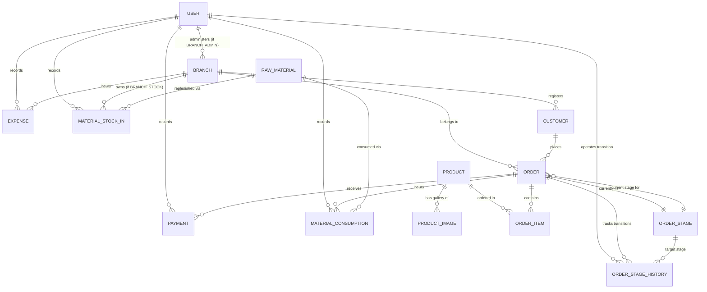

# Furniture Business ERP — Database Design & Data Model

## 1. Entity-Relationship Diagram (ERD)

---

## 2. Relational Schema Specification

### 2.1 Core Identity & Branch Management

#### `User`
Stores authenticated business actors (Owner and Branch Administrators).
- `id`: `String` (UUID, Primary Key)
- `email`: `String` (Unique, indexed)
- `passwordHash`: `String`
- `fullName`: `String`
- `phone`: `String?`
- `role`: `UserRole` (`OWNER`, `BRANCH_ADMIN`)
- `branchId`: `String?` (Foreign Key -> `Branch.id`, Unique constraint: exactly one branch per administrator)
- `isActive`: `Boolean` (Default: `true`)
- `createdAt`: `DateTime` (Default: `now()`)
- `updatedAt`: `DateTime` (Updated automatically)

#### `Branch`
Represents physical showrooms or workshop locations.
- `id`: `String` (UUID, Primary Key)
- `name`: `String` (Unique)
- `code`: `String` (Unique, short code e.g. "BR-CENTRAL")
- `address`: `String`
- `phone`: `String?`
- `stockMode`: `StockMode` (`MAIN_STOCK`, `BRANCH_STOCK`)
- `isActive`: `Boolean` (Default: `true`)
- `createdAt`: `DateTime` (Default: `now()`)
- `updatedAt`: `DateTime` (Updated automatically)

---

### 2.2 Product Catalog & Showroom

#### `Product`
Furniture catalog models.
- `id`: `String` (UUID, Primary Key)
- `sku`: `String` (Unique, indexed)
- `name`: `String` (Indexed)
- `category`: `String` (e.g., "Living Room", "Dining", "Office", "Bedroom")
- `description`: `String?`
- `dimensions`: `String?` (e.g. "200cm x 100cm x 75cm")
- `basePrice`: `Decimal(14, 2)` (Guideline selling price)
- `estimatedProductionDays`: `Int?`
- `isActive`: `Boolean` (Default: `true`)
- `createdAt`: `DateTime` (Default: `now()`)
- `updatedAt`: `DateTime` (Updated automatically)

#### `ProductImage`
Image assets linked to catalog products.
- `id`: `String` (UUID, Primary Key)
- `productId`: `String` (Foreign Key -> `Product.id`, indexed)
- `imageUrl`: `String` (S3 object URL)
- `thumbnailUrl`: `String?`
- `isPrimary`: `Boolean` (Default: `false`)
- `fileSizeBytes`: `Int`
- `mimeType`: `String`
- `sortOrder`: `Int` (Default: `0`)
- `createdAt`: `DateTime` (Default: `now()`)

---

### 2.3 Customers & Orders

#### `Customer`
Walk-in clients registered upon visiting.
- `id`: `String` (UUID, Primary Key)
- `branchId`: `String` (Foreign Key -> `Branch.id`, branch of intake)
- `fullName`: `String` (Indexed)
- `phone`: `String` (Indexed, E.164 normalized)
- `email`: `String?`
- `address`: `String?`
- `notes`: `String?`
- `createdAt`: `DateTime` (Default: `now()`)
- `updatedAt`: `DateTime` (Updated automatically)

#### `OrderStage`
Customizable order progress stages defined by Owner.
- `id`: `String` (UUID, Primary Key)
- `name`: `String` (e.g., "Deposit Received", "Timber Cutting", "Polishing", "Completed")
- `color`: `String` (Hex/Tailwind tag color e.g., "#8B5A2B")
- `sequenceOrder`: `Int` (Pipeline sorting, indexed)
- `isFinalStage`: `Boolean` (Default: `false`, marks delivery/fulfillment)
- `isActive`: `Boolean` (Default: `true`)
- `createdAt`: `DateTime` (Default: `now()`)
- `updatedAt`: `DateTime` (Updated automatically)

#### `Order`
Main furniture sales and manufacturing contracts.
- `id`: `String` (UUID, Primary Key)
- `orderNumber`: `String` (Unique, e.g., "ORD-2026-00101")
- `customerId`: `String` (Foreign Key -> `Customer.id`, indexed)
- `branchId`: `String` (Foreign Key -> `Branch.id`, indexed)
- `currentStageId`: `String` (Foreign Key -> `OrderStage.id`, indexed)
- `totalAgreedPrice`: `Decimal(14, 2)` (Authoritative contract price)
- `totalPaid`: `Decimal(14, 2)` (Cached aggregate of all confirmed payments)
- `outstandingBalance`: `Decimal(14, 2)` (Computed: `totalAgreedPrice - totalPaid`)
- `deadlineDate`: `DateTime` (Promised completion/delivery date)
- `notes`: `String?`
- `createdAt`: `DateTime` (Default: `now()`, indexed)
- `updatedAt`: `DateTime` (Updated automatically)

#### `OrderItem`
Items included within an order.
- `id`: `String` (UUID, Primary Key)
- `orderId`: `String` (Foreign Key -> `Order.id`, indexed)
- `productId`: `String?` (Foreign Key -> `Product.id`, nullable for custom bespoke items)
- `itemDescription`: `String` (Custom specification or product name)
- `quantity`: `Int` (Default: `1`)
- `unitPrice`: `Decimal(14, 2)`
- `subtotal`: `Decimal(14, 2)` (Quantity * unitPrice)

#### `OrderStageHistory`
Immutable audit log of all order stage progressions.
- `id`: `String` (UUID, Primary Key)
- `orderId`: `String` (Foreign Key -> `Order.id`, indexed)
- `fromStageId`: `String?` (Foreign Key -> `OrderStage.id`)
- `toStageId`: `String` (Foreign Key -> `OrderStage.id`)
- `changedByUserId`: `String` (Foreign Key -> `User.id`)
- `notes`: `String?`
- `changedAt`: `DateTime` (Default: `now()`, indexed)

---

### 2.4 Inventory, Costing & Stock Transactions

#### `RawMaterial`
Raw material catalog definitions.
- `id`: `String` (UUID, Primary Key)
- `code`: `String` (Unique)
- `name`: `String` (Indexed)
- `category`: `String` (e.g., "Wood", "Fabric", "Foam", "Hardware", "Finish")
- `unitOfMeasurement`: `String` (e.g. "Meter", "SqMeter", "Kg", "Piece", "Liter")
- `currentStockQuantity`: `Decimal(14, 3)` (Current total on hand)
- `currentUnitCost`: `Decimal(14, 2)` (Current weighted average or standard unit cost)
- `reorderAlertQuantity`: `Decimal(14, 3)?`
- `isActive`: `Boolean` (Default: `true`)
- `createdAt`: `DateTime` (Default: `now()`)
- `updatedAt`: `DateTime` (Updated automatically)

#### `MaterialStockIn`
Replenishment purchases batch records.
- `id`: `String` (UUID, Primary Key)
- `rawMaterialId`: `String` (Foreign Key -> `RawMaterial.id`, indexed)
- `branchId`: `String?` (Foreign Key -> `Branch.id`, null if MAIN_STOCK, indexed)
- `receivedQuantity`: `Decimal(14, 3)`
- `unitCost`: `Decimal(14, 2)`
- `totalCost`: `Decimal(14, 2)` (receivedQuantity * unitCost)
- `supplierInvoiceRef`: `String?`
- `receivedDate`: `DateTime` (Default: `now()`, indexed)
- `recordedByUserId`: `String` (Foreign Key -> `User.id`)

#### `MaterialConsumption`
Material consumed during production of a specific order.
- `id`: `String` (UUID, Primary Key)
- `orderId`: `String` (Foreign Key -> `Order.id`, indexed)
- `rawMaterialId`: `String` (Foreign Key -> `RawMaterial.id`, indexed)
- `branchId`: `String?` (Foreign Key -> `Branch.id`, where consumption occurred)
- `consumedQuantity`: `Decimal(14, 3)`
- `unitCostAllocated`: `Decimal(14, 2)` (Frozen historical unit cost snapshot)
- `totalMaterialCost`: `Decimal(14, 2)` (consumedQuantity * unitCostAllocated)
- `consumedAt`: `DateTime` (Default: `now()`)
- `recordedByUserId`: `String` (Foreign Key -> `User.id`)

---

### 2.5 Payments, Expenses & Synchronization

#### `Payment`
Prepayments and progress payment disbursements.
- `id`: `String` (UUID, Primary Key)
- `orderId`: `String` (Foreign Key -> `Order.id`, indexed)
- `amount`: `Decimal(14, 2)`
- `paymentType`: `PaymentType` (`PREPAYMENT`, `PROGRESS_PAYMENT`, `FINAL_SETTLEMENT`)
- `paymentMethod`: `String` (e.g., "Cash", "Bank Transfer", "Telebirr")
- `referenceNumber`: `String?`
- `paymentDate`: `DateTime` (Default: `now()`, indexed)
- `recordedByUserId`: `String` (Foreign Key -> `User.id`)
- `idempotencyKey`: `String?` (Unique, indexed)

#### `Expense`
Operating overhead and branch expenses.
- `id`: `String` (UUID, Primary Key)
- `branchId`: `String?` (Foreign Key -> `Branch.id`, null if enterprise-wide)
- `category`: `String` (e.g., "Rent", "Utilities", "Maintenance", "Tools", "General")
- `amount`: `Decimal(14, 2)`
- `expenseDate`: `DateTime` (Default: `now()`, indexed)
- `description`: `String`
- `receiptRef`: `String?`
- `recordedByUserId`: `String` (Foreign Key -> `User.id`)
- `idempotencyKey`: `String?` (Unique, indexed)

#### `IdempotencyRecord`
Guarantees duplicate-submission prevention for offline sync and critical endpoints.
- `id`: `String` (UUID, Primary Key)
- `idempotencyKey`: `String` (Unique, indexed)
- `userId`: `String` (Foreign Key -> `User.id`)
- `resourceType`: `String` (e.g., "ORDER", "PAYMENT", "CONSUMPTION")
- `resourceId`: `String?`
- `responsePayload`: `Json`
- `createdAt`: `DateTime` (Default: `now()`, expires after 30 days)

---

## 3. Database Transaction Boundaries

All critical business operations must execute within transactional boundaries (`prisma.$transaction`):

| Operation | Tables Modified in Single Transaction | Integrity Constraints Guaranteed |
| :--- | :--- | :--- |
| **Create Order + Initial Prepayment** | `Order`, `OrderItem`, `Payment`, `OrderStageHistory`, `IdempotencyRecord` | Order total, initial payment, remaining balance, and initial stage history created atomically. |
| **Record Subsequent Payment** | `Payment`, `Order`, `IdempotencyRecord` | Order `totalPaid` incremented and `outstandingBalance` decremented atomically. |
| **Material Stock-In** | `MaterialStockIn`, `RawMaterial` | Incoming batch recorded, `currentStockQuantity` incremented, and `currentUnitCost` updated atomically. |
| **Record Material Consumption** | `MaterialConsumption`, `RawMaterial`, `Order` | Stock balance validated ($Q_{\text{avail}} \ge Q_{\text{consumed}}$), stock deducted, and frozen cost allocated atomically. |
| **Order Stage Advance** | `Order`, `OrderStageHistory` | Current stage updated and audit log appended atomically. |
