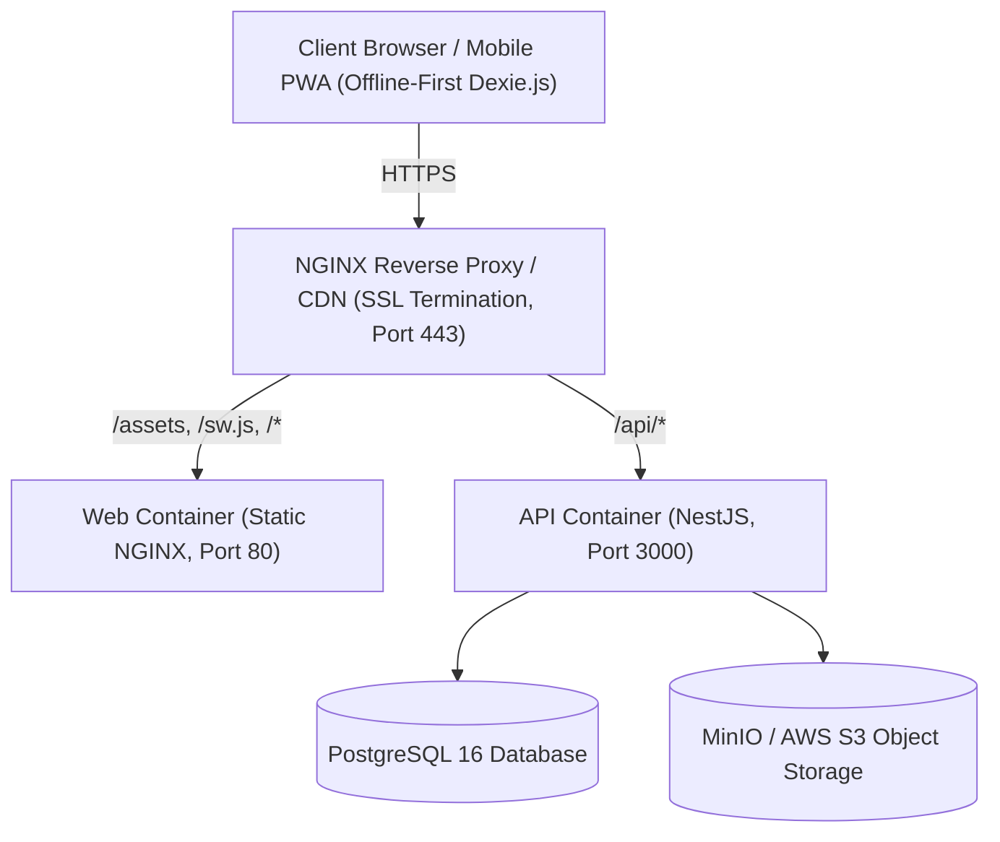

# Production Deployment Guide

This guide describes the end-to-end procedure for deploying the **Furniture Business ERP** to production environments.

---

## 1. Prerequisites & Infrastructure Requirements

- **Server Specs (Minimum)**:
  - 2 vCPUs
  - 4 GB RAM (8 GB recommended for concurrent Sharp image processing)
  - 40 GB SSD storage
  - Linux (Ubuntu 22.04 LTS / Debian 12 / Rocky Linux 9 recommended)
- **Software Dependencies**:
  - Docker Engine >= 24.0
  - Docker Compose v2 >= 2.20
  - Optional: Node.js 22 LTS & pnpm 9 (if building bare-metal outside Docker)
  - Domain name with DNS A/AAAA records pointing to host IP
  - TLS/SSL Certificate (via Let's Encrypt / Certbot or Cloudflare)

---

## 2. Architecture Overview in Production



---

## 3. Configuration & Secrets Setup

1. Clone the repository on the target server:
   ```bash
   git clone <repository-url> /opt/furniture-erp
   cd /opt/furniture-erp
   ```

2. Copy the production environment template:
   ```bash
   cp .env.production.example .env.production
   ```

3. Generate secure cryptographic secrets:
   ```bash
   # Generate 64-character random hex strings
   openssl rand -hex 32  # For POSTGRES_PASSWORD
   openssl rand -hex 32  # For JWT_SECRET
   openssl rand -hex 32  # For COOKIE_SECRET
   openssl rand -hex 32  # For MINIO_ROOT_PASSWORD
   ```

4. Edit `.env.production` and substitute all secrets, database credentials, and production domain in `CORS_ORIGIN`.

---

## 4. Containerized Deployment Steps

### Step 1: Launch Database and Storage Services
```bash
docker compose -f docker-compose.prod.yml --env-file .env.production up -d postgres minio
```
Verify health:
```bash
docker compose -f docker-compose.prod.yml ps
```

### Step 2: Run Database Migrations
Run Prisma migrations to deploy all SQL schema tables and indices:
```bash
docker compose -f docker-compose.prod.yml --env-file .env.production run --rm api \
  pnpm --filter @furniture/api prisma:deploy
```

### Step 3: Seed Initial Business Owner Account
Initialize the owner account:
```bash
docker compose -f docker-compose.prod.yml --env-file .env.production run --rm api \
  pnpm --filter @furniture/api prisma:seed
```
*Default initial owner credentials configured in seed script: `owner@furniture.local` / `FurnitureOwner2026!`. Must be changed immediately upon first login.*

### Step 4: Build and Launch Web & API Services
```bash
docker compose -f docker-compose.prod.yml --env-file .env.production up -d --build api web
```

---

## 5. SSL / TLS Reverse Proxy Setup (Host NGINX Example)

Configure host-level NGINX for automatic SSL certificate management via Certbot:

```nginx
# /etc/nginx/sites-available/furniture-erp.conf
server {
    listen 80;
    server_name erp.yourdomain.com;
    return 301 https://$host$request_uri;
}

server {
    listen 443 ssl http2;
    server_name erp.yourdomain.com;

    ssl_certificate /etc/letsencrypt/live/erp.yourdomain.com/fullchain.pem;
    ssl_certificate_key /etc/letsencrypt/live/erp.yourdomain.com/privkey.pem;
    ssl_protocols TLSv1.2 TLSv1.3;
    ssl_ciphers HIGH:!aNULL:!MD5;

    # Maximum file upload size (for high-resolution furniture imagery)
    client_max_body_size 15M;

    # API and uploads reverse proxy
    location /api/ {
        proxy_pass http://127.0.0.1:3000;
        proxy_http_version 1.1;
        proxy_set_header Upgrade $http_upgrade;
        proxy_set_header Connection 'upgrade';
        proxy_set_header Host $host;
        proxy_set_header X-Real-IP $remote_addr;
        proxy_set_header X-Forwarded-For $proxy_add_x_forwarded_for;
        proxy_set_header X-Forwarded-Proto $scheme;
        proxy_cache_bypass $http_upgrade;
    }

    # Frontend PWA reverse proxy
    location / {
        proxy_pass http://127.0.0.1:80;
        proxy_http_version 1.1;
        proxy_set_header Host $host;
        proxy_set_header X-Real-IP $remote_addr;
        proxy_set_header X-Forwarded-For $proxy_add_x_forwarded_for;
        proxy_set_header X-Forwarded-Proto $scheme;
    }
}
```

---

## 6. Zero-Downtime Migration & Rollback Strategy

1. **Schema Migrations**:
   - Backward-compatible database schema changes must be applied before rolling out new application code.
   - Run `prisma migrate deploy`.
2. **Blue/Green or Rolling App Restart**:
   ```bash
   docker compose -f docker-compose.prod.yml --env-file .env.production up -d --no-deps --build api
   docker compose -f docker-compose.prod.yml --env-file .env.production up -d --no-deps --build web
   ```
3. **Emergency Rollback**:
   - Keep previous Docker image tags available locally.
   - If a rollback is needed, revert the image tag and restart containers.
