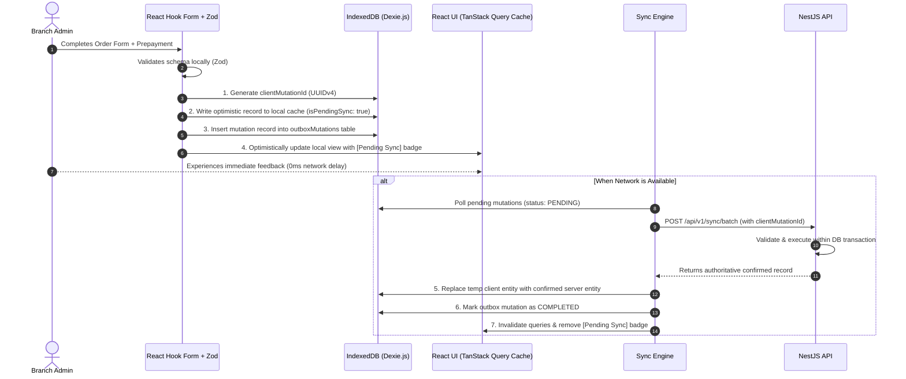

# Furniture Business ERP — Offline-First Architecture & Synchronization Engine

## 1. Offline Philosophy & Operational Objectives

In furniture manufacturing workshops and remote showroom branches, internet connectivity can be intermittent or slow. A naive "online-only web app" disrupts customer intake and shop-floor order updates.

The Furniture Business ERP implements an **Offline-First PWA Architecture**:
1. All core branch operations (customer registration, order logging, order stage updates, material consumption logging, payment receipts, and photo attachments) can be performed while completely disconnected.
2. The user interface remains responsive and immediately confirms user actions locally.
3. Once network connectivity is restored, a robust background synchronization engine reconciles local mutations with the server authoritatively and without duplicating financial or stock records.

---

## 2. PWA Foundation & Application Shell Caching

The application is bundled using `vite-plugin-pwa` powered by Google Workbox:

1. **Manifest Configuration:**
   - Standalone display mode with custom theme color (`#3E2723` rich wood brown) and background color (`#FAF8F5` warm neutral).
   - Responsive icons (192x192, 512x512, maskable icons) enabling full home-screen installation on iOS and Android.
2. **Service Worker Caching Strategy:**
   - **Static App Shell (`CacheFirst`):** HTML, compiled JS bundles, CSS, fonts, and Lucide SVG icons are cached immediately on install. New versions update via background cache-busting prompts.
   - **Product Showroom Images (`StaleWhileRevalidate` with LRU eviction):** Cached locally up to 200MB or 30 days.
   - **Dynamic Business APIs (`NetworkFirst` with Fallback):** Read requests attempt network first; if offline, return recent cached snapshots from IndexedDB.

---

## 3. Client Storage Strategy (Dexie.js / IndexedDB)

IndexedDB is used for all structured local data storage via Dexie.js.

### 3.1 Local Tables Schema

```typescript
// Dexie Database Definition
export class FurnitureERPDatabase extends Dexie {
  cachedProducts!: Table<CachedProduct, string>;
  cachedCustomers!: Table<CachedCustomer, string>;
  cachedOrders!: Table<CachedOrder, string>;
  cachedMaterials!: Table<CachedMaterial, string>;
  cachedStages!: Table<CachedStage, string>;
  
  // Persistent Outbox for queued mutations
  outboxMutations!: Table<OutboxMutation, string>;
  
  // Offline Image Blobs
  offlineImageBlobs!: Table<OfflineImageBlob, string>;

  constructor() {
    super('FurnitureERP_OfflineDB');
    this.version(1).stores({
      cachedProducts: 'id, name, category, isActive',
      cachedCustomers: 'id, fullName, phone, branchId',
      cachedOrders: 'id, orderNumber, customerId, branchId, currentStageId, createdAt',
      cachedMaterials: 'id, name, category, currentStockQuantity',
      cachedStages: 'id, sequenceOrder, isActive',
      outboxMutations: 'id, entityType, clientMutationId, status, createdAt',
      offlineImageBlobs: 'id, clientMutationId, mimeType, createdAt'
    });
  }
}
```

---

## 4. The Outbox Mutation Workflow

Every state-modifying action follows a strict transactional flow on the client:



---

## 5. Offline Image Capture Flow

When an administrator takes a product or workshop photo offline:
1. The camera or file input delivers a `File` or `Blob`.
2. The client validates dimensions, format (JPEG/PNG/WebP), and size (<5MB).
3. The raw binary Blob is stored directly in `offlineImageBlobs` indexed by a generated `clientMutationId`.
4. A local `URL.createObjectURL(blob)` is assigned to the UI for instant preview.
5. The associated product mutation in `outboxMutations` references this `clientMutationId`.
6. When connectivity returns:
   - The sync engine reads the Blob from IndexedDB.
   - It performs a multipart upload to `/api/v1/storage/upload`.
   - The server uploads to S3, returns the permanent CDN URL, and associates it with the product record.
   - The local Blob is safely pruned from IndexedDB.

---

## 6. Conflict Handling & Resolution Policies

Distributed offline operations can create conflicts if two administrators update the same record or if stock changes. The ERP applies explicit resolution rules:

| Operation Type | Potential Conflict Scenario | Resolution Strategy |
| :--- | :--- | :--- |
| **Customer Registration** | Customer registered offline at Branch A, but phone number already exists on server. | **Server Authority:** The server merges the offline order under the existing customer profile and returns the canonical `customerId`. |
| **Material Consumption** | Material consumed offline, but upon sync, server stock is insufficient due to another branch's consumption. | **Reconciliation Conflict:** Mutation status changes to `CONFLICT_INSUFFICIENT_STOCK`. UI alerts administrator with a resolution sheet: "Stock deficient by X units. Reconcile or replenish stock to complete sync." |
| **Order Stage Advance** | Order stage advanced offline while another operator updated notes online. | **Field-Level Convergence:** Stage transition is applied chronologically; server timestamps order history. |
| **Order Payment** | Duplicate payment submission caused by connection drop during request. | **Idempotent Deduplication:** Backend matches `clientMutationId` against `IdempotencyRecord` and ignores duplicate payment. |

---

## 7. Synchronization Triggers & UI Feedback

### 7.1 Sync Triggers
1. **Window Online Event (`navigator.onLine` & `window.addEventListener('online')`):** Immediate trigger upon reconnect.
2. **App Startup:** Checks outbox when app launches.
3. **Periodic Foreground Heartbeat:** If online, checks outbox every 60 seconds.
4. **Manual User Action:** "Sync Now" button in the status bar.
5. **Background Sync API (where supported by browser):** Queues service worker sync tag.

### 7.2 UI Transparency Principles
- **Persistent Network Banner:** Discretely indicates "Offline Mode — Working Locally" when disconnected.
- **Sync Badge Counter:** Displays number of queued mutations (e.g. `[ 3 changes pending sync ]`).
- **Unconfirmed Transaction Pill:** Items created offline display a warm amber badge: `Unconfirmed (Local)` until server confirmation returns.
