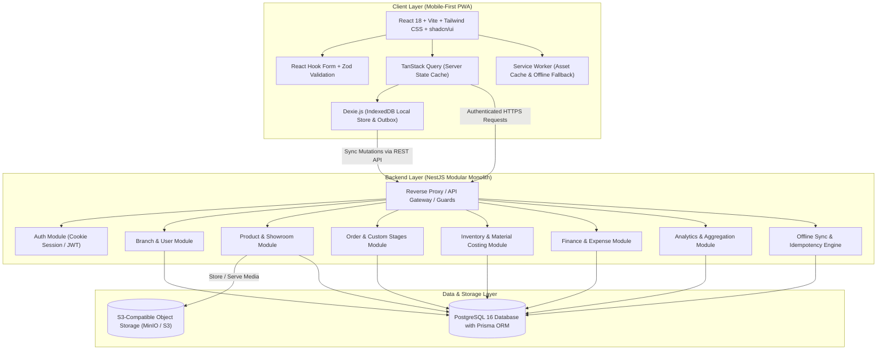
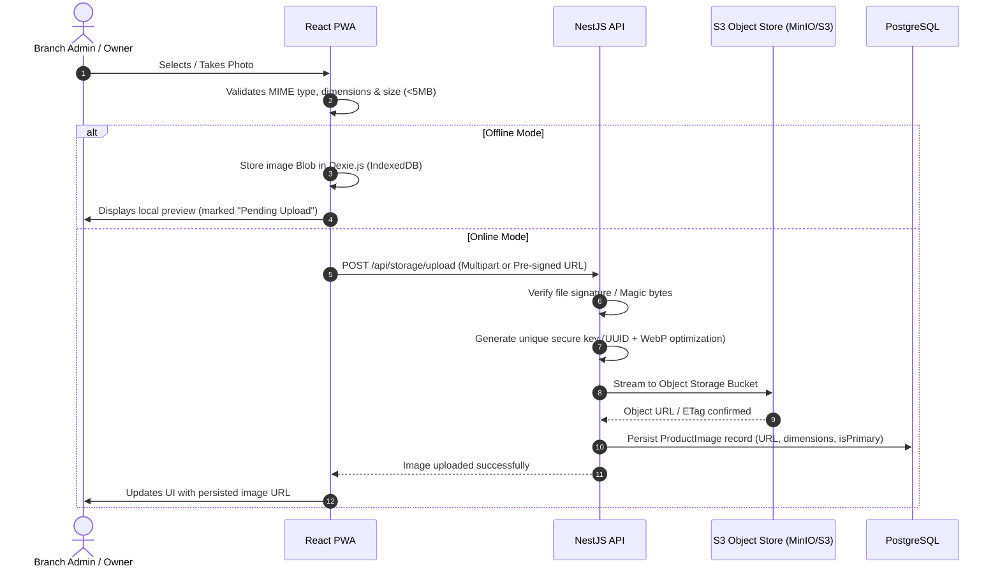

# Furniture Business ERP — System Architecture

## 1. System Overview & Architecture Diagram

The application is structured as a **Modular Monolith** designed for high cohesion, low coupling, deterministic testing, and straightforward deployment.



---

## 2. Monorepo Repository Structure

The project uses `pnpm` workspaces for clean separation of concerns:

```text
furniture-erp/
├── apps/
│   ├── web/                     # React Frontend (Vite + PWA)
│   │   ├── public/              # Manifest, icons, offline fallbacks
│   │   ├── src/
│   │   │   ├── app/             # Application entry, router, providers
│   │   │   ├── components/      # UI component library (shadcn/ui customized)
│   │   │   ├── db/              # Dexie.js IndexedDB schema & outbox tables
│   │   │   ├── hooks/           # Shared hooks (useAuth, useSync, useNetworkStatus)
│   │   │   ├── modules/         # Domain-driven frontend feature modules
│   │   │   │   ├── auth/
│   │   │   │   ├── branches/
│   │   │   │   ├── catalog/
│   │   │   │   ├── customers/
│   │   │   │   ├── orders/
│   │   │   │   ├── inventory/
│   │   │   │   ├── finance/
│   │   │   │   └── analytics/
│   │   │   └── lib/             # API client, utilities, formatting helpers
│   │   ├── package.json
│   │   └── vite.config.ts
│   └── api/                     # NestJS Backend Application
│       ├── src/
│       │   ├── common/          # Filters, guards, interceptors, decorators
│       │   ├── config/          # Environment configuration & validation
│       │   ├── database/        # PrismaService and transaction management
│       │   ├── modules/         # Domain-driven NestJS modules
│       │   │   ├── auth/
│       │   │   ├── branches/
│       │   │   ├── products/
│       │   │   ├── customers/
│       │   │   ├── orders/
│       │   │   ├── inventory/
│       │   │   ├── finance/
│       │   │   ├── analytics/
│       │   │   ├── storage/     # S3-compatible file storage service
│       │   │   └── sync/        # Idempotent batch sync handler
│       │   ├── app.module.ts
│       │   └── main.ts
│       ├── prisma/
│       │   ├── schema.prisma    # Authoritative Prisma schema
│       │   ├── migrations/      # Versioned SQL migrations
│       │   └── seed.ts          # Database seed scripts
│       ├── package.json
│       └── tsconfig.json
├── packages/
│   └── shared/                  # Shared TypeScript interfaces, DTOs & enums
│       ├── src/
│       │   ├── contracts/       # Request/Response types
│       │   ├── enums/           # UserRole, StockMode, etc.
│       │   └── validation/      # Shared Zod schemas where applicable
│       └── package.json
├── docs/                        # Architecture, Blueprint & Business documentation
├── docker-compose.yml           # Local dev services (Postgres, MinIO)
├── pnpm-workspace.yaml
└── package.json
```

---

## 3. Frontend Architecture

1. **Framework & Bundler:** React 18+ with TypeScript, bundled using Vite for rapid HMR and optimized tree-shaking.
2. **Routing:** `react-router-dom` v6 with layout-based route grouping:
   - Public layouts (Login).
   - Owner layout (Navigation with enterprise analytics, branch management, global catalog).
   - Branch Administrator layout (Touch-friendly POS/workshop layout, quick customer registration, branch orders, local stock).
3. **State Management & Data Layer:**
   - **Server State:** TanStack Query (React Query) handles caching, background revalidation, stale-while-revalidate policies, and optimistic UI transitions.
   - **Local Persistence & Outbox:** Dexie.js (IndexedDB) acts as the local offline store.
   - **Form State:** React Hook Form coupled with Zod schemas for fast validation without unnecessary re-renders.
4. **UI Design System:**
   - Tailwind CSS configured with custom color tokens reflecting the warm neutral aesthetic (deep charcoal text, warm sandstone backgrounds, rich wood/walnut accent colors).
   - Customized shadcn/ui components: accessible dialogs, sheets for mobile drawers, data tables, badges, and alerts.

---

## 4. Backend Architecture

1. **Framework:** NestJS modular architecture enforcing separation of concerns:
   - **Controllers:** Handle HTTP serialization, Swagger decorators, and route mapping.
   - **Services:** Contain strictly isolated business logic.
   - **DTOs:** Strong contract validation via `class-validator` and `class-transformer`.
   - **Prisma Client:** Type-safe database queries and explicit transactional boundaries.
2. **Global Cross-Cutting Concerns:**
   - `HttpExceptionFilter`: Standardizes all error responses into a consistent JSON envelope `{ statusCode, error, message, timestamp, path }`.
   - `LoggingInterceptor`: Tracks request latencies, endpoint hits, and error rates.
   - `ValidationPipe`: Enforces `whitelist: true`, `forbidNonWhitelisted: true`, and automatic type transformation.

---

## 5. Authentication & Authorization Architecture

1. **Authentication:**
   - Secure HTTP-only, `SameSite=Lax` (or `Strict`), encrypted session cookies containing a signed JWT or session identifier.
   - No sensitive auth tokens stored in client `localStorage` or `IndexedDB`, preventing XSS token exfiltration.
2. **Authorization Guards:**
   - `RolesGuard`: Enforces role-based permissions (`OWNER` vs `BRANCH_ADMIN`).
   - `BranchAccessGuard`: Validates branch tenancy:
     - If the user is an `OWNER`, access to any branch query/mutation is authorized.
     - If the user is a `BRANCH_ADMIN`, the target `branchId` in the request parameters or body is compared against the user's assigned `branchId`. If they do not match, the request is immediately rejected with `403 Forbidden`.
   - The frontend never dictates user permissions or tenancy; the server derives branch context from the authenticated identity.

---

## 6. Image Upload & Storage Architecture



1. **Format & Sizing Limits:** Only WebP, JPEG, and PNG formats are accepted; files are capped at 5MB.
2. **Processing & Optimization:** Images are converted/optimized (e.g., using `sharp` or client-side downsampling) to generate standardized thumbnails for mobile views.
3. **Database Decoupling:** Binary image data is never written into PostgreSQL or localStorage; PostgreSQL only stores metadata records (`id`, `productId`, `imageUrl`, `thumbnailUrl`, `sizeBytes`, `mimeType`, `createdAt`).

---

## 7. Reliability, Idempotency & Fault Tolerance

1. **Database ACID Transactions:** Every business action touching multiple tables (e.g., Order creation + Initial Prepayment receipt; Stock replenishment + Batch pricing; Stock consumption + Order cost accumulation) runs inside a Prisma interactive transaction `$transaction`.
2. **Idempotency Engine:**
   - Client requests generate an `X-Idempotency-Key` (client UUID).
   - The backend checks `IdempotencyLog` table before processing critical financial or inventory mutations.
   - If an operation with the same key was already successfully executed, the server re-returns the cached response without duplicate execution.
